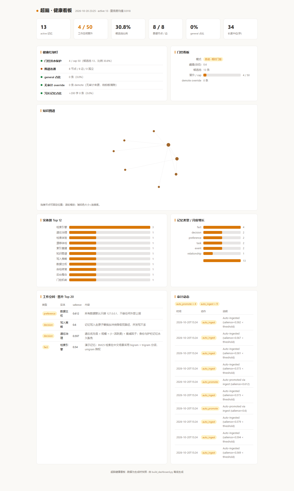

# 超脑 Super Brain

**Persistent memory + knowledge graph for AI agents. Pure Python stdlib, zero external dependencies, local-first.**

> 中文名「**超脑**」。给 AI Agent 用的「第二大脑」：跨会话长期记忆、BM25 中文检索、知识图谱、遗忘治理与自动自检。纯 Python 标准库实现，数据全部留在本地。

这是一个 **Agent 认知层**——为 Claude Code、Cursor、Codex、WorkBuddy 这类编码 Agent 提供跨会话记忆与治理。**不是**稍后读工具，**不是**书签应用，**不是**方法论模板库。



*`sb_dashboard.py` 离线生成的单文件看板，纯标准库，默认只绑 127.0.0.1。*


## 为什么值得用

| 你遇到的问题 | 超脑的做法 |
|---|---|
| Agent 每次开新会话就失忆 | 对话即入库；`memory search` 跨会话召回，六通道 RRF 融合 + 中文错别字容错 |
| 记忆越存越多、越存越脏 | 遗忘治理（规模 × 活性 × 衰减三因子）+ 后台整合只出 proposal、永不自动 apply |
| 记忆和磁盘/图谱悄悄漂移 | `SB drift` 只读体检，四态检测（过期 / 孤儿 / 应有未有 / 未基线化），退出码可直接接 cron |
| 中文检索被英文分词器坑死 | CJK bigram + trigram 分词、unigram 降权，单路 BM25 |
| 数据不想上云 | 纯本地文件，默认只绑 `127.0.0.1`，无外部服务依赖 |

## 快速开始

### 路径 A：独立 CLI（任何 Python 3.10+ 环境）

不需要 WorkBuddy，不需要任何 Agent 平台，只要 Python。

```bash
git clone https://github.com/A1m1ng777888/super-brain.git
cd super-brain

python scripts/superbrain.py init
python scripts/superbrain.py memory add --content "你的第一条记忆" --type fact --entity demo
python scripts/superbrain.py memory search "记忆"
python scripts/superbrain.py stats
```

### 路径 B：作为 WorkBuddy Skill（可选）

```bash
git clone https://github.com/A1m1ng777888/super-brain.git ~/.workbuddy/skills/super-brain
```

克隆后在 WorkBuddy 中加载 `super-brain` skill 即可使用。这条路额外获得的是模型侧的自然语言调用（不用记命令）——核心引擎与路径 A 完全同一个。

### 验证环境

```bash
python scripts/superbrain.py selfcheck
python scripts/superbrain.py version      # 确认版本与数据目录
```

## 核心能力

| 能力 | 说明 |
|---|---|
| **持久记忆引擎** | 对话即入库，跨会话不丢上下文；写入采用「原子替换 + 冲突降级」双路径，并发写不丢 |
| **BM25 中文检索** | CJK bigram + trigram 分词、unigram 降权；单路 BM25 取代早期被噪声拖垮的多路融合 |
| **知识图谱** | 实体关系自动抽取与自动建图，支持 Mermaid 导出 |
| **遗忘治理** | 遗忘优先级 = 规模 × (1−活跃度) × 衰减因子；三档软切降权，身份/护栏记忆永久豁免 |
| **后台整合（零 LLM）** | 实体归一、近重复合并、冗长压缩、知识更新链；只出 proposal，永不自动 apply |
| **相对门控** | 阈值取候选池 salience 排名第 k 高，分布漂移免重标（scale-free） |
| **本地工作台** | 纯标准库 HTTP 服务，默认只绑 127.0.0.1；看板 / 体检趋势 / 暗色模式 / 移动端自适应 |
| **自检与修复** | 内置 12 项自检，发现问题可 surgical 修补 |
| **漂移四态体检** | `SB drift` 只读检测记忆与磁盘/图谱的漂移：过期、孤儿、应有未有、未基线化 |
| **Obsidian 双向同步** | 记忆可落地到本地知识库 |

## 数据目录

默认 `~/.workbuddy/super-brain/`，可用环境变量 `SUPERBRAIN_DATA_DIR` 覆盖。
记忆按 workspace 隔离存放于 `workspaces/<name>/`；workspace 名默认由当前工作目录向上查找 `.workbuddy/` 标记推导。

> ⚠️ **在含 `.workbuddy` 的目录树下运行测试要注意**：`resolve_workspace()` 会把 cwd 所属项目解析成 workspace，测试将读写该项目的真实记忆。跑测试请用中性目录，或显式设置 `SUPERBRAIN_DATA_DIR` 指向临时目录。

## 同名项目区分

GitHub 上叫 Super Brain / SuperBrain 的仓库有数百个，容易被认错。明确一下边界：

| 仓库 | 是什么 | 与本项目的关系 |
|---|---|---|
| `sidinsearch/superbrain` | AI save-it-later（存 Instagram / YouTube / 网页） | 不同赛道：它管理内容收藏，本项目管理 Agent 的认知状态 |
| `superhero-tech/super-brain` | Product Builder Second Brain（产品方法论模板集） | 不同赛道：它是模板与工作流，本项目是可运行的引擎 |
| `m3talux/superbrain` | Claude Code 会话记忆 → Obsidian markdown | 相近。它偏「会话原始记录落盘」，本项目偏「记忆治理 + 图谱 + 漂移体检」 |
| `endyii/superbrain-lt` | MCP memory-extraction server（Postgres + pgvector） | 相近。它需要 Postgres 服务，本项目零外部服务依赖、纯本地文件 |

本仓库英文名 `super-brain`，中文名「超脑」—— 中文这个词在 GitHub 仓库名维度目前没有占用者，用中文名检索可唯一定位到本项目。

## 许可

MIT —— 见 [LICENSE](LICENSE)。

## 版本历史

详见 [CHANGELOG.md](CHANGELOG.md)。
